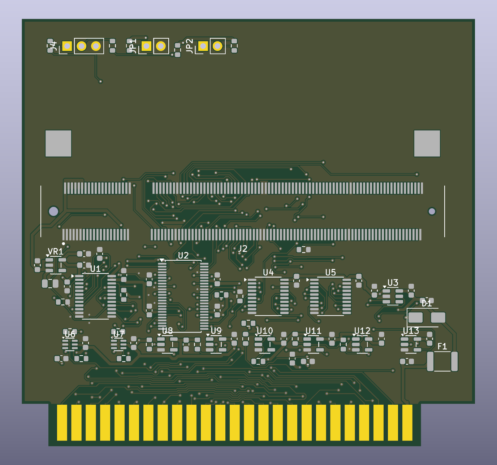
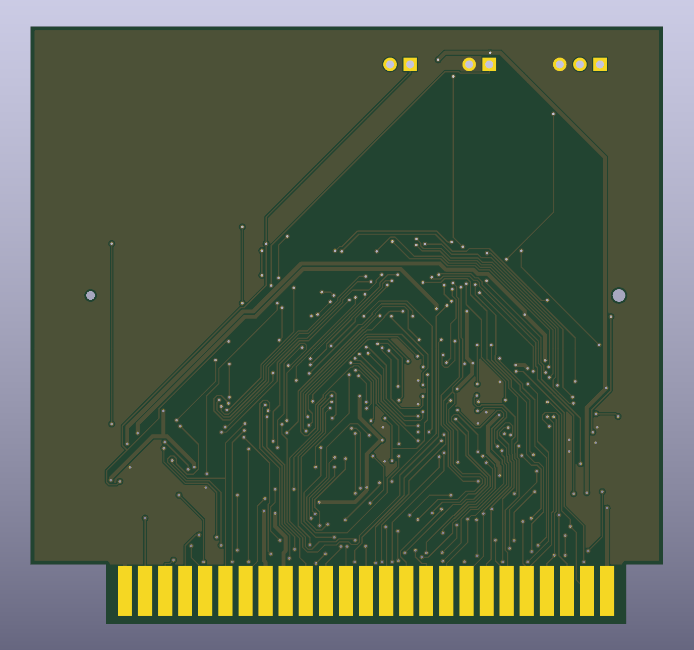

<!-- SPDX-License-Identifier: CERN-OHL-S-2.0 -->

# hw — the physical card

The open-hardware side of gs-os-nix: Apple II slot cards designed as code. SKiDL
writes the netlist, scripts place and route the board in KiCad 10, and mutation-proven
gates check it. The design, its decisions and the owner's review checklist are in
[docs/HARDWARE.md](../docs/HARDWARE.md).

## The bus carrier

The first board is a development carrier, not the release card (HW-3). It holds the
**bus section** that the integrated card will reuse unchanged: the Apple II edge
fingers, level translators, input and listen-only buffers, open-drain outputs and the
reset hold. A DDR2 SODIMM-200 socket takes an **iCESugar-Pro** module (LFE5U-25F,
32 MB SDRAM).

| Top | Bottom |
|---|---|
|  |  |

- 2 layers, 80 mm × 68 mm above the fingers. It fits any slot, 1–7.
- The module lies flat over the empty band above the socket. Its own USB programs it
  and carries capture readout (HW-13). The carrier adds a UART header (J4) and two
  jumpers: SAFE (JP1) and the reset-hold bypass (JP2).
- Power: slot +5 V → polyfuse F1 → Schottky D1 → module; an AP2112K makes the
  translators' 3.3 V from the module side (HW-14).
- DRC is clean (0 errors, 0 unconnected), and the board matches the netlist pin for pin.

**Status:** designed, routed and gated. It is not yet fabricated, and not yet tested in
a IIgs. Rev A, the integrated ECP5 card, is ordered only after this carrier has run in
a real machine (HW-9).

## Layout

| Path | What |
|---|---|
| `src/` | SKiDL subcircuits; `slot_bus.py` is the bus section |
| `carrier/` | The carrier: `top.py`, `pins.toml` (the FPGA pin map), `placement.toml`, the module's SODIMM map, the routed `carrier.kicad_pcb` |
| `lib/gsnix.pretty/` | Generated footprints: the slot fingers and the SODIMM socket |
| `tools/` | Board builder, router, fab export, and the `check_*.py` gates |
| `tests/` | The tools' tests (`hw-tests`) |
| `img/` | The pictures above, refreshed with `just -f hw/justfile readme-images` |

## Using it

```sh
nix develop .#hw
just -f hw/justfile check          # every gate, each selftest first
just -f hw/justfile fab            # gerbers, BOM, CPL, renders in build/hw/fab
nix build .#hw-carrier-fab         # the same order package, from Nix
```

`nix flake check` runs the same gates as `hw-*` checks.

## Licence

Board files are **CERN-OHL-S-2.0** ([LICENSE](LICENSE)). The tools, the tests and the
RTL are GPL-3.0-or-later, like the rest of the repo.
